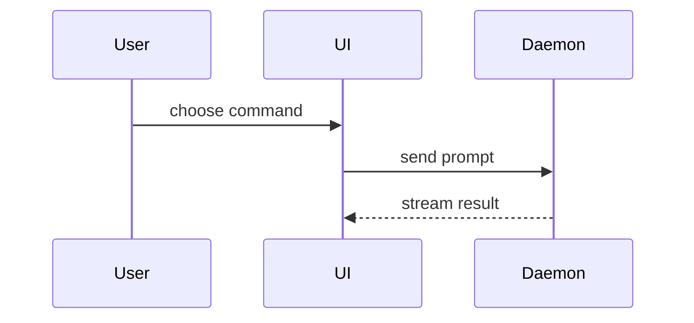

# Show me

Help the user understand the current topic visually. Skip the preamble, keep prose to a line or two per visual. Pick the smallest view that makes the key point clear: usually one, rarely more than two.

Keep only the calls, files, props, states and boundaries needed to answer the current question or to compare the options under discussion. Use real names from the code, with a path when ownership matters.

## Rendering context

Replies render in the Pi TUI, usually inside a Herdr pane that may be split.

- Every inline block must fit the pane. Aim for 80 columns or less. For a view that may be wider, get the pane width and keep a margin of 4 columns for the code-block indent: `herdr pane layout --pane "$HERDR_PANE_ID" | jq '.result.layout.panes[] | select(.pane_id == env.HERDR_PANE_ID) | .rect.width'`.
- Pi draws ` ```mermaid ` blocks as Unicode diagrams for `flowchart`/`graph`, `sequenceDiagram`, `stateDiagram-v2`, `classDiagram` and `erDiagram` only. It ignores `style`, `classDef` and `linkStyle`. A diagram wider than the pane shows as raw source.
- Keep Mermaid narrow: `flowchart TD` over `LR`, labels of one to three words, at most five sequence participants, few crossing edges. Run the Mermaid checks below before replying. If it does not fit, or needs another diagram type (`gantt`, `pie`, `mindmap`, `timeline`...), use a wide view.
- ` ```diff ` blocks are colored. Use them for before/after.

## Views

Pseudocode, for logic or an algorithm:

```text
on(save)
  if content is unchanged
    return cached result
  write new content
  return fresh result
```

Call tree, for runtime control flow:

```text
submitForm
  createSession
    persistPrompt
    launchAgent
  navigateToSession
```

Component tree, for UI structure, with the state and module boundaries that matter:

```tsx
<SessionPage> (apps/web/src/routes/session.tsx)
  useSessionEvents()
  <SessionToolbar>
    <RunSkillButton> (packages/ui)
```

Shallow file tree, for file responsibilities or a broad refactor:

```text
src/
├── commands/       # parses user actions
├── sessions/       # owns session state
└── transport/      # sends API requests
```

Mermaid, for interactions, data flow, state machines or schemas:



Diff, when the point is what changes and the surrounding shape already exists. Apply it to any of the views above, keeping just enough context to locate the change:

```diff
 submitForm
   createSession
     persistPrompt
+    expandSkillMention
     launchAgent
-  navigateToSession
+  navigateToSession
+    subscribeToEvents
```

Whole block instead of a diff when most of it is new, when omitted context would hide ownership or order, or when the user needs a copyable target shape.

## Mermaid checks

Write the source to `/tmp/show-me/<slug>.mmd`, outside the repo, using the subset both Pi and termaid read: `subgraph Title`, one-line labels, no `id["Title"]` subgraph titles, no `<br/>` or other HTML.

1. Syntax. termaid exits 0 even on syntax it does not understand and draws it literally, so this must print nothing:
   ```bash
   termaid /tmp/show-me/<slug>.mmd | grep -E '<br|\["'
   ```
2. Width. Measure with Pi-like box padding. Inline if the result is at most the pane width minus 4, otherwise use a wide view:
   ```bash
   termaid /tmp/show-me/<slug>.mmd --padding-x 1 --padding-y 0 | perl -CI -nlE '$m = length if length > $m }{ say $m'
   ```
   Do not use `--width ... --strict-width` for this: termaid tightens gaps to pass, Pi does not.

## Wide view in a Herdr tab

When a view cannot fit the pane without losing the point, show it in a dedicated Herdr tab: full workspace width, horizontal scrolling, closed with `q`.

1. Write the source under `/tmp/show-me/`: `<slug>.mmd` for Mermaid, after the checks above, otherwise `<slug>.<ext>` with an extension that `bat` highlights (`.diff`, `.tsx`, `.txt`).
2. Open the tab and start the viewer. The trailing `exit` closes the tab when the user quits the viewer.
   ```bash
   pane=$(herdr tab create --workspace "$HERDR_WORKSPACE_ID" --cwd /tmp/show-me --label show-me --focus | jq -r '.result.root_pane.pane_id')
   herdr pane run "$pane" "FORCE_COLOR=1 termaid <slug>.mmd --theme nord --padding-y 0 --gap 2 | less -RS; exit"
   # text view: "bat --color=always --style=plain <slug>.<ext> | less -RS; exit"
   ```
3. Reply with one line on what the tab shows and how to close it (`q`). Keep any inline visual in the reply small.

Open one tab per view and never close tabs you did not create. Outside Herdr (`HERDR_ENV` unset), skip the tab and give the file path with the viewer command.
